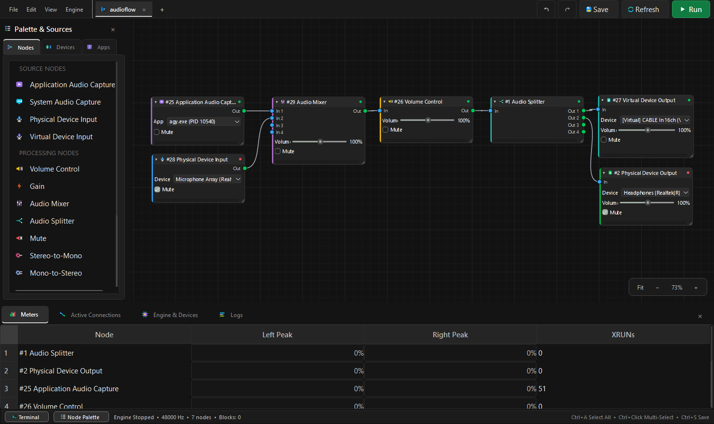

<div align="center">
  
  <br />
  

  <br /><br />

  <p><strong>Visual node-based low-latency Windows audio routing studio &amp; virtual device router.</strong></p>

  <p>
    
    
    
    
    
    
    <a href="https://github.com/Jit-Roy/Phonoryx/releases/tag/v1"></a>
  </p>

  <br />

  
</div>

---

## Download (Standalone Release)

Ready-to-run portable standalone build for Windows (no Python or development environment setup required):

- 📦 **Latest Release:** [**Phonoryx v1**](https://github.com/Jit-Roy/Phonoryx/releases/tag/v1)
- 💾 **Direct Download:** [**Phonoryx-v1-windows.zip**](https://github.com/Jit-Roy/Phonoryx/releases/download/v1/Phonoryx-v1-windows.zip) (~45 MB)

Simply extract the zip archive and run `Phonoryx.exe`.

## Requirements

- **Operating System:** Windows 10 (build 20348+) or Windows 11 (x64)
  > Windows 10/11 WASAPI Process Loopback support is required for per-application audio capture.
- **Python:** Python `3.10` – `3.12` (when running from source or building the executable)
- **Visual C++ Redistributable:** Microsoft Visual C++ Redistributable (x64)
- **No CMake or C++ Compiler Required:** A precompiled native audio engine (`assets/bin/phonoryx_engine.dll`) is already bundled in this repository, so end users do **not** need CMake or Visual Studio Build Tools.
- **Optional Virtual Audio Cables:** [VB-Cable](https://vb-audio.com/Cable/) or similar virtual audio drivers if you want virtual cable input/output routing endpoints.

## Installing Requirements

Create a virtual environment and install the Python dependencies:

```powershell
python -m venv .venv
.\.venv\Scripts\Activate.ps1
pip install -r requirements.txt
```

## Running the App

Launch Phonoryx directly from source (no CMake build step needed):

```powershell
python main.py
```

Or run the package module directly:

```powershell
python -m phonoryx
```

## Building the Executable (PyInstaller)

A preconfigured [`Phonoryx.spec`](Phonoryx.spec) is included. It automatically bundles `assets/`, the precompiled `phonoryx_engine.dll`, and the application icon (`assets/icons/app_icon.ico`):

```powershell
pyinstaller Phonoryx.spec --noconfirm
```

The standalone bundle is written to `dist\Phonoryx\Phonoryx.exe`. End users can run it directly with zero CMake or Python setup.

## Cache Location

Phonoryx stores its workspace cache (`workspace_cache.json` — open tabs, node layouts, device/app selections, and dock state) in the Windows `LocalAppData` folder:

```text
%LOCALAPPDATA%\Phonoryx
```

(Typically `C:\Users\<YourUsername>\AppData\Local\Phonoryx\workspace_cache.json`.)

## Supported Virtual Audio Drivers

Phonoryx detects and integrates with standard Windows virtual audio drivers through WASAPI shared mode. The engine's `DeviceManager` automatically recognizes virtual endpoints by inspecting driver friendly names (matching `virtual`, `cable`, `voicemeeter`, and `wave link`):

- **VB-Audio CABLE**: VB-Cable Standard, A+B, and C+D virtual audio cables.
- **VB-Audio VoiceMeeter**: VoiceMeeter Input / Output, VoiceMeeter Aux, and VoiceMeeter VAIO3.
- **Virtual Audio Cable (VAC)**: Eugene Muzychenko VAC lines 1–N.
- **Elgato Wave Link**: Virtual routing channels (System, Game, Music, Browser, Voice Chat, SFX, Aux).
- **Windows Virtual & Loopback Endpoints**: Steam Streaming Audio, OBS Virtual Audio, and system-defined virtual endpoints.

Virtual inputs and outputs are marked with `is_virtual = true` in device lists, allowing Phonoryx to route inter-application audio without hardware loopback cables.

## Software Audio Pipeline Latency & Buffer Architecture (Computed)

Phonoryx is engineered for real-time low-latency audio processing with tight ring buffer targets:

| Software Metric | Configured Target | Purpose |
| :--- | :--- | :--- |
| **Capture Ring Target** | **10 ms** (480 frames @ 48 kHz) | Minimized input buffering with 4 ms deadband to prevent drift hunting |
| **Render Buffer Duration** | **20 ms** (shared-mode duration) | Tuned shared-mode WASAPI buffer with 10 ms prebuffer |
| **Render Ring Target** | **10 ms** (480 frames @ 48 kHz) | Low-latency output pacing with 4 ms deadband |
| **DSP Block Size** | **10 ms** (480 frames @ 48 kHz) | Remainder-compensated high-resolution RT clock |
| **Algorithmic Delay** | **1 block (10.0 ms)** | Measured via automated click-impulse test in test harness |
| **Total Software Path (Computed)** | **~20 ms** | Computed internal software buffer latency (capture ring + render ring) |

### Physical Round-Trip Measurement (Hardware + OS Shared Mode)
While the internal software path is $\approx 20\text{ ms}$, real-world round-trip latency through physical audio hardware in Windows WASAPI Shared Mode includes the Windows audio engine (`audiodg.exe`) OS mixing period ($\approx 10\text{ ms}$ capture + $\approx 10\text{ ms}$ render) and physical DAC/ADC converter reconstruction filters:
- **Measured Physical Loopback (Line-Out $\to$ Line-In Cable):** **$\approx 48\text{ -- }58\text{ ms}$** end-to-end round-trip measured on standard Windows 10/11 WASAPI shared-mode hardware codecs.

### Slaved Primary Output Clocking
To eliminate audio drift and minimize latency on the primary output, Phonoryx slaves the real-time processing loop directly to the primary physical speaker DAC (`AF_NODE_SPEAKER_OUTPUT`). When the master DAC requests audio via WASAPI's hardware event callback, it signals the engine tick directly. This removes a drift resampling stage on the primary output (`drift = 1.0`). Secondary outputs and capture endpoints drift-trim against this master clock using a shared `BufferDriftController`.

For devices with larger packet periods (such as Bluetooth A2DP headsets and certain USB DACs with 20 ms or 40 ms periods), the engine matches block cadence (processing multiple blocks per DAC tick) and uses an adaptive watchdog timeout (3.5× device period, minimum 100 ms) so the watchdog never misfires during normal playback. If the master DAC is disconnected or stalls, the engine safely falls back to a high-resolution multimedia timer (`CREATE_WAITABLE_TIMER_HIGH_RESOLUTION`), ensuring zero freezes or audio stutters.

### Parameter Validation & Output Soft Limiter
All node parameters are strictly sanitized both in the Python UI layer (model post-init, canvas sliders, inspector panel, and serialization) and inside the C++ engine (`volume` ∈ [0.0, 2.0], `gain_db` ∈ [-60.0, +24.0] dB, `eq_gains` ∈ [-18.0, +18.0] dB). Additionally, every audio signal routed to an output node (speakers, virtual cables, WAV recorder, or test sinks) passes through a hyperbolic tangent (`tanh`) soft limiter before transmission, ensuring signals remain safely within `[-1.0, +1.0]` with smooth saturation rather than harsh digital clipping.

## License & Third-Party Notices

This project is licensed under the **MIT License** — see the [LICENSE](LICENSE) file for details.

### Third-Party Libraries (LGPLv3)
Phonoryx utilizes **PySide6** and **Qt6**, which are licensed under the **GNU Lesser General Public License version 3 (LGPLv3)**. Phonoryx interfaces with Qt dynamically via shared libraries (`.pyd` and `.dll`). In compliance with LGPLv3, users have the right to inspect, modify, and relink the Qt/PySide6 libraries used by Phonoryx (including replacing the Qt binaries inside `_internal/PySide6/` in the standalone distribution). Upstream Qt source code is available at [qt.io](https://download.qt.io/official_releases/qt/) and [code.qt.io](https://code.qt.io/cgit/pyside/pyside-setup.git).
